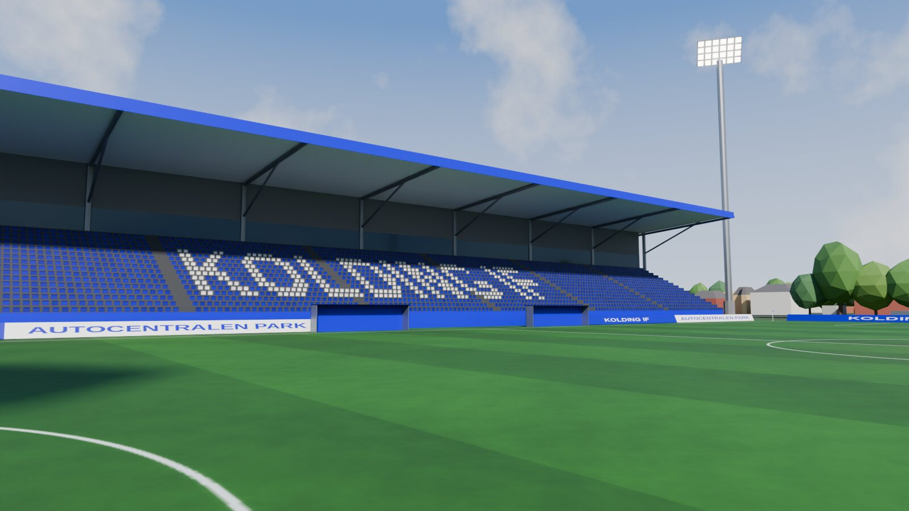
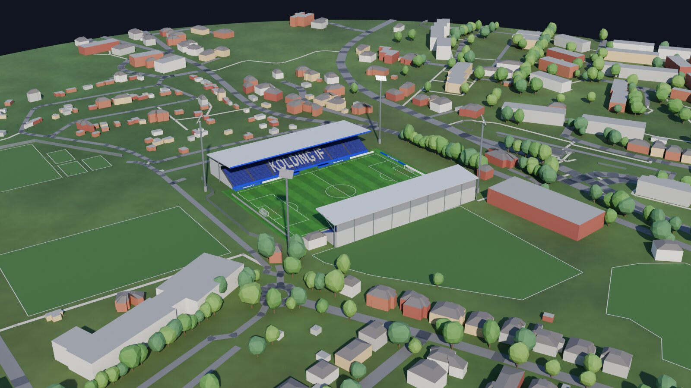

# Comment marche un mod

Je voulais jouer une carrière qui part de rien, dans un petit club nordique. Le jeu de foot auquel je joue n'a pas ces divisions, alors j'ai regardé ce qu'il faudrait changer pour les ajouter. Cette question m'a surtout appris comment un jeu est construit.

Ce dépôt résume ce que j'ai compris. Il ne contient ni le mod, ni fichier du jeu, ni code.

## Un jeu, c'est surtout des données

Le moteur fait tourner le jeu, mais presque tout ce qu'on voit à l'écran vient de fichiers de données. Un mod change ces données et touche rarement au code. On peut donc partir d'une question simple : dans quel fichier vit ce qui m'agace ?

| Ce qui m'agace | Où ça vit | Ce qu'un mod peut faire |
|---|---|---|
| Mon championnat n'existe pas | Des tables de clubs et de joueurs, des fichiers texte pour les compétitions | Ajouter des lignes et des règles |
| Tous les stades se ressemblent | Des modèles 3D et des textures | Remplacer des pièces |
| Le speaker ne connaît pas mon club | Des banques de sons et une table qui choisit la phrase | Ajouter ou remplacer des enregistrements |
| Les petits clubs ont de mauvais maillots | Des textures | Les remplacer |
| Je suis un inconnu et j'ai déjà des milliers de likes | Je n'ai pas cherché | Rien, tout ce qui agace ne mérite pas un mod |

## Le chemin d'un mod

1. **Ouvrir.** Les fichiers d'un jeu sont rangés dans de grosses archives. Des outils écrits par des passionnés savent les ouvrir et sortir leur contenu dans des formats courants : du WAV pour le son, du FBX pour la 3D, du XML pour la logique.
2. **Lire.** Avant de changer quoi que ce soit, on regarde comment le jeu se sert de ces fichiers. C'est souvent là qu'on comprend pourquoi quelque chose nous agaçait.
3. **Prouver qu'on ne casse rien.** On relit un fichier, on le réécrit sans rien changer et on compare. Si les deux versions diffèrent, on ne comprend pas encore le format.
4. **Modifier.** On travaille ensuite avec des outils ordinaires : Blender pour la 3D, un script pour les tables, un modèle de synthèse vocale pour les voix.
5. **Réimporter.** L'outil produit un petit fichier qui contient seulement ce qui change. Mon fichier de test pèse 173 Ko, pour un jeu de 72 Go. En général, un chargeur applique ce fichier au lancement et les fichiers d'origine restent en place.
6. **Tester dans le jeu.** L'éditeur peut accepter un fichier que le jeu refusera ensuite. Seul le jeu peut dire si ça marche.

## Exemple : le speaker anglais des petits stades

Dans beaucoup de petits stades, le speaker parle anglais et ne nomme jamais le club. Les fichiers expliquent pourquoi.

Le jeu essaie d'abord une phrase qui nomme l'équipe. S'il n'en trouve pas, il prend une phrase générique, du type "Goal for the hosts!". Une table relie chaque enregistrement à l'identifiant d'un club. Pour les buts en anglais, elle couvre 20 des 24 clubs de la quatrième division anglaise, et aucun club des premières divisions danoise, suédoise et norvégienne.

La langue suit une logique proche. Les pays nordiques ont un code de langue, mais aucune banque de voix ne lui correspond, ce qui explique probablement l'anglais.

La bonne nouvelle, c'est que ces mécanismes existent déjà. L'éditeur a accepté des phrases de but en danois, générées avec Piper, un modèle de synthèse vocale open source. La phrase vérifiée ressort de l'éditeur presque identique, avec une corrélation de 0,9998. Personne ne l'a encore entendue dans le jeu.

## Exemple : pourquoi les stades se ressemblent

La base du jeu relie jusqu'à 61 clubs au même stade générique. Un petit stade est donc un décor partagé, et il est fait de pièces : tribunes, portes, toit, mâts. Les 27 pièces exportées d'un de ces stades totalisent environ 61 000 triangles. Elles sont en mètres, à l'échelle réelle, et centrées sur le terrain.

Une tribune rehaussée de 50 % dans Blender est entrée dans l'éditeur et en est ressortie avec sa nouvelle forme. Il reste à savoir si le public, l'éclairage précalculé et les collisions suivent.

Pour créer un stade sans le modéliser à la main, un script part d'OpenStreetMap. Il lit l'emprise des tribunes et des bâtiments, les routes et les arbres, puis il construit le tout dans Blender en moins d'une minute.

La carte donne les positions. Le script estime les hauteurs, les gradins et les toits, donc le résultat est plausible et faux dans le détail. Cette méthode dépend aussi de la carte : sur six stades danois essayés, trois étaient assez bien dessinés. Ce modèle n'existe que dans Blender, et il n'a jamais été chargé dans le jeu.

## Le rôle de l'IA

Claude Code a écrit presque tout le code et mené les essais décrits ici. Il va vite, et il annonce ses erreurs sur le même ton que ses réussites. Il m'a par exemple assuré que l'éditeur ne tournait que sous Windows, et c'était faux : l'éditeur tourne aussi sous Wine.

Mon travail consiste à choisir ce qui m'agace, à limiter le projet et à demander des preuves. Mon intervention la plus utile tient en trois mots : "are you sure??". Chaque étape écrit donc un fichier qu'on peut ouvrir et lire, et un résultat compte seulement s'il a tourné sur de vraies données.

## Où ça en est

Au 4 novembre 2026, rien de tout cela n'a tourné dans le jeu. Le code relit et réécrit la vraie base à l'identique, et l'éditeur accepte le son et la 3D. Le test décisif reste à faire : une ligue factice dans une vraie carrière. La conversion des notes, qui doit créer des milliers de joueurs, n'est pas écrite non plus.

Le mod reste un projet personnel, joué hors ligne, et je ne le publie pas.

---

Données cartographiques © les contributeurs d'OpenStreetMap, licence ODbL : https://www.openstreetmap.org/copyright. Les images sont des rendus Blender et ne contiennent aucun élément du jeu. Aucun club n'est associé à ce projet.
